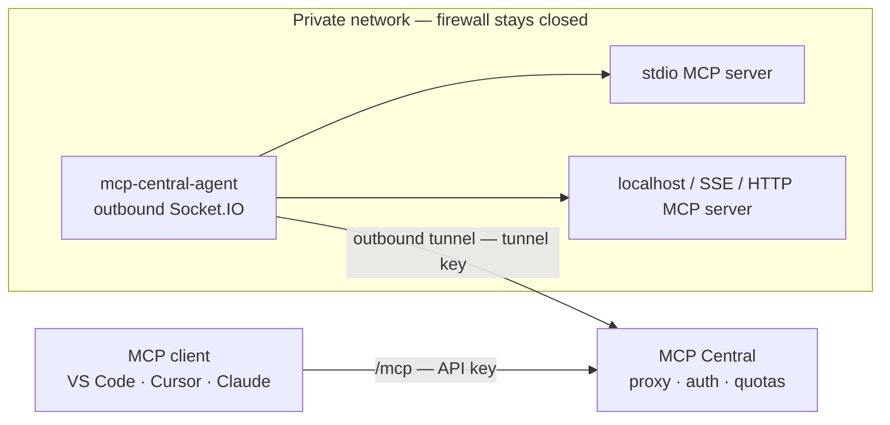

<p align="center">
  <em>Reach the MCP servers that live on your machine — through MCP Central, without opening a port.</em>
</p>

<h1 align="center">mcp-central-agent</h1>

<p align="center">
  <a href="https://nodejs.org/"></a>
  <a href="https://www.typescriptlang.org/"></a>
  <a href="https://modelcontextprotocol.io/"></a>
  <a href="LICENSE"></a>
</p>

`mcp-central-agent` is the companion CLI of
**[MCP Central](https://github.com/circle-rd/mcp-central)** — the authenticated MCP
proxy that aggregates every MCP server behind a single `/mcp` endpoint.

It runs on the machine that hosts private MCP servers (`stdio` processes, `localhost`
HTTP/SSE servers, LAN addresses) and dials **out** to MCP Central. To your MCP clients,
a tunnelled server is indistinguishable from a directly registered one: same
namespaced tools, same endpoint, same authentication.



---

## Features

- **Outbound-only tunnel** — one authenticated Socket.IO connection to
  `{serverUrl}/tunnel`. No inbound port, no VPN, no public DNS, no port forwarding.
- **Live endpoint management** — endpoints are pushed from the MCP Central UI
  (add / update / remove / enable / disable / refresh); the agent starts and stops local
  MCP clients accordingly, without restart.
- **Three transports** — `stdio` (spawns a local process), `streamable-http`
  (POST, with automatic SSE fallback), and `sse`.
- **Tools and resources** — tool discovery and invocation, resource listing, resource
  reads, and forwarding of `notifications/resources/*` changes back to Central.
- **Resilient** — unlimited tunnel reconnection (1 s → 30 s back-off) and per-endpoint
  reconnect (1 s, 2 s, 5 s, 10 s, 30 s), with connection status reported live to Central.
- **Validated at the boundary** — the configuration file and every payload received over
  the tunnel are validated with [Zod](https://zod.dev/) before use.
- **Programmable** — the package also exports `McpCentralAgent`, `AgentTunnel`,
  `LocalClient` and `loadConfig` for embedding in your own tooling.

---

## Requirements

- **Node.js >= 22**
- An MCP Central instance (self-hosted) and a **tunnel** created in its UI.

---

## Quick Start

### 1. Create a tunnel in MCP Central

Open **MCP Servers → Add Local Tunnel**, give it a name, and copy the generated
`tunnel_...` key — it is shown **once**.

### 2. Initialize the agent on the private machine

```bash
npx mcp-central-agent init
```

The prompts validate each answer as you type:

- **Server URL** — e.g. `https://your-mcp-central.example.com`
- **Tunnel name** — must match the tunnel created in step 1
- **Tunnel key** — `tunnel_xxxxxxxx…`

A `mcp-agent.json` file is written in the current directory.

### 3. Start the agent

```bash
npx mcp-central-agent start
```

The agent connects to MCP Central, receives the endpoints assigned to its tunnel,
starts each local MCP server and announces their tools and resources. Assign
endpoints to the tunnel from the UI — no restart required.

---

## Configuration File

`mcp-agent.json` (default path; override with `--config`):

```json
{
  "serverUrl": "https://your-mcp-central.example.com",
  "agentName": "My Laptop",
  "apiKey": "tunnel_xxxxxxxxxxxxxxxxxxxxxxxxxxxxxxxxxxxxxxxx"
}
```

| Field       | Description                                                     |
| ----------- | --------------------------------------------------------------- |
| `serverUrl` | Base URL of your MCP Central instance                           |
| `agentName` | Tunnel name, as created in MCP Central                          |
| `apiKey`    | Tunnel key generated by MCP Central (secret — never share it)   |

The file is read as a strict JSON object: unknown fields, a non-URL `serverUrl` or a key
that does not start with `tunnel_` are rejected with a message naming the faulty field.
Add `mcp-agent.json` to your project's `.gitignore`; it contains a secret and must not be committed.

---

## Supported Transports

| Transport         | Description                                                                 |
| ----------------- | --------------------------------------------------------------------------- |
| `stdio`           | Spawns a local process (e.g. `npx @modelcontextprotocol/server-filesystem`)   |
| `streamable-http` | Connects to a local Streamable HTTP MCP server; falls back to SSE on failure |
| `sse`             | Connects to a local SSE MCP server                                           |

The transport and connection details of each endpoint are configured in MCP Central, not
in the agent configuration file. `stdio` servers are spawned with the local user's
environment plus the variables configured for the endpoint server-side (which take
precedence).

---

## CLI Reference

```
mcp-central-agent init [--output <path>]   Create a config file interactively
mcp-central-agent start [--config <path>]  Start the agent
mcp-central-agent --version                Print the agent version
```

| Option                 | Command | Description                               |
| ---------------------- | ------- | ----------------------------------------- |
| `-o, --output <path>`  | `init`  | Output file path (default `mcp-agent.json`) |
| `-c, --config <path>`  | `start` | Config file path (default `mcp-agent.json`) |

`SIGINT` / `SIGTERM` shut the agent down gracefully: local MCP servers are closed and the
tunnel is disconnected.

---

## Programmatic Use

```ts
import { McpCentralAgent, loadConfig } from "mcp-central-agent";

const config = await loadConfig("./mcp-agent.json");
const agent = new McpCentralAgent(config);
agent.start();

process.on("SIGTERM", () => void agent.stop());
```

The public API also exposes the tunnel (`AgentTunnel`), the per-endpoint MCP client
(`LocalClient`), the configuration and protocol schemas (`AgentConfigSchema`,
`EndpointConfigSchema`, `ToolCallPayloadSchema`, `ResourceReadPayloadSchema`) and
`AGENT_VERSION`. Exports are a compatibility surface: breaking one requires a version bump.

---

## Security

- **Outbound only** — the agent dials out; nothing listens on the private network.
- **Per-tunnel key** — stored as a SHA-256 hash by MCP Central and never shown again
  after creation. It is a secret: keep it out of logs and source control.
- **Optional IP allow-list** — restrict which source IP may open the tunnel (enforced
  by MCP Central).
- **Live revocation** — deleting a tunnel disconnects the agent and rejects pending calls.
- **Quotas** — `maxTunnelsPerAgent` / `maxEndpointsPerAgent` come from the auth-service plan.
- **Validated boundary** — strict schemas reject malformed or unknown fields; connection
  details come exclusively from MCP Central.

---

## Development

```bash
npm ci                  # install (single package manager: npm)
npm run typecheck       # tsc --noEmit
npm run typecheck:tests
npm run lint            # ESLint (flat config, typescript-eslint)
npm test                # Vitest
npm run build           # tsc → dist/
npm run dev             # tsc --watch
npm audit --omit=dev --audit-level=moderate
```

Contributions follow the repository contract in [`AGENTS.md`](AGENTS.md), which mirrors
the doctrine of [`mcp-central/AGENTS.md`](https://github.com/circle-rd/mcp-central/blob/develop/AGENTS.md).
Work happens on `develop`; `main` is the production branch.

### Continuous integration

`ci.yml` runs on every pull request and on pushes to `main` / `develop`:

- type-check (sources and tests), lint, unit tests and build on Node 22 and Node 24;
- `npm audit --omit=dev --audit-level=moderate` on the production dependency tree.

`nightly.yml` is triggered manually from `develop` or `main`. It reuses `ci.yml` as its
quality gate, then publishes `<next-version>-nightly.<YYYYMMDD>.g<sha>` under the
`nightly` npm dist-tag. Re-running the same commit is a no-op.

Both publishing workflows use **npm Trusted Publishing (OIDC)** — no long-lived npm token
is stored — so each workflow file must be registered as a Trusted Publisher for the
package on npmjs.com (`release.yml` for releases, `nightly.yml` for nightlies).

### Releasing

The release workflow (`release.yml`) builds and publishes to npm and GitHub Packages when
a semver tag is pushed, then creates the GitHub release:

```bash
git tag v0.2.0
git push origin v0.2.0
```

---

## Related Projects

| Project                                                 | Description                                                                       |
| ------------------------------------------------------- | --------------------------------------------------------------------------------- |
| [mcp-central](https://github.com/circle-rd/mcp-central) | The proxy: Node.js + IOServer (Fastify + Socket.IO), PostgreSQL, Redis, Vue 3 SPA |

---

## License

MIT — © CIRCLE Cyber. See [LICENSE](LICENSE).
